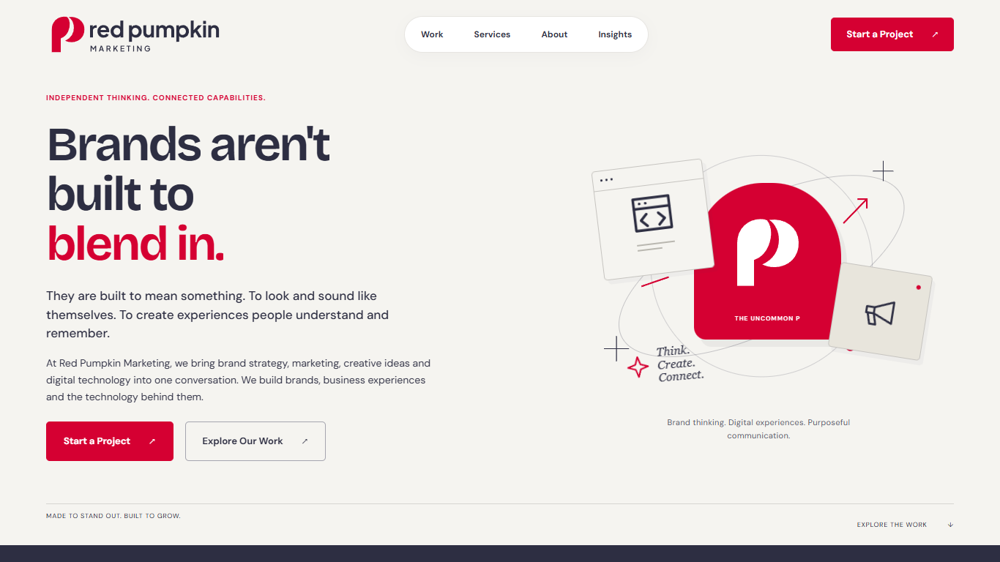
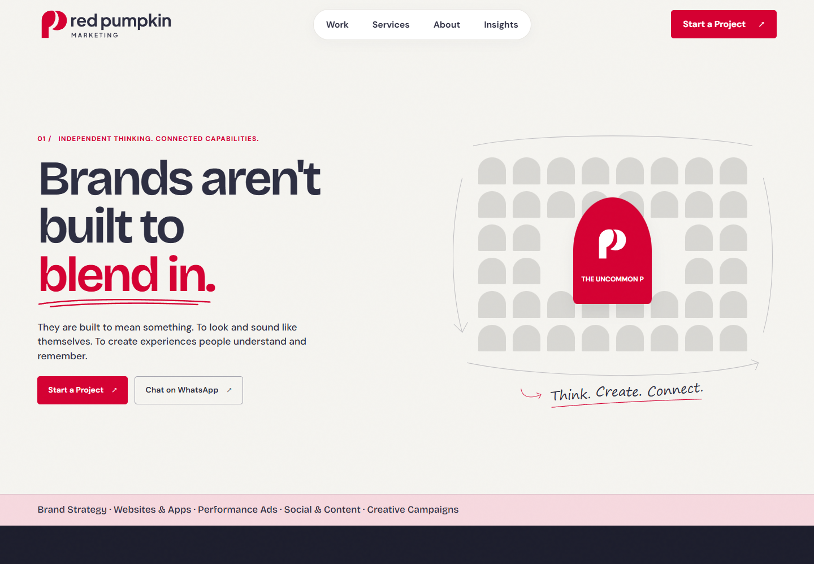
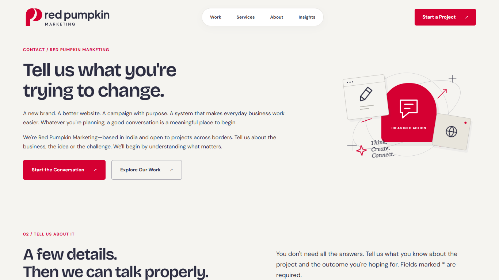
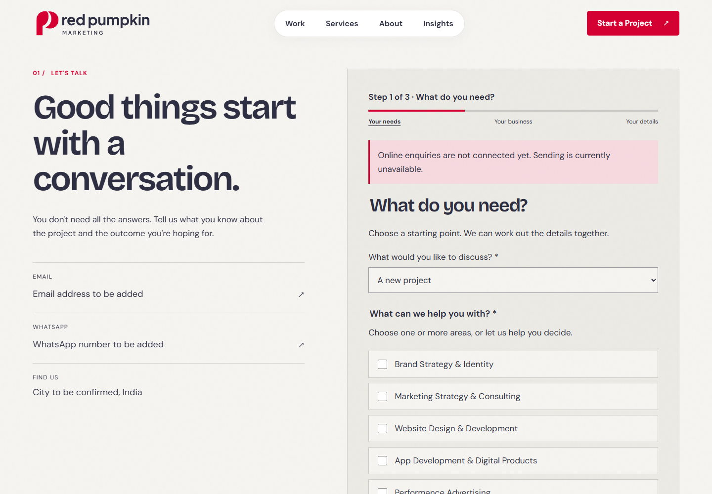
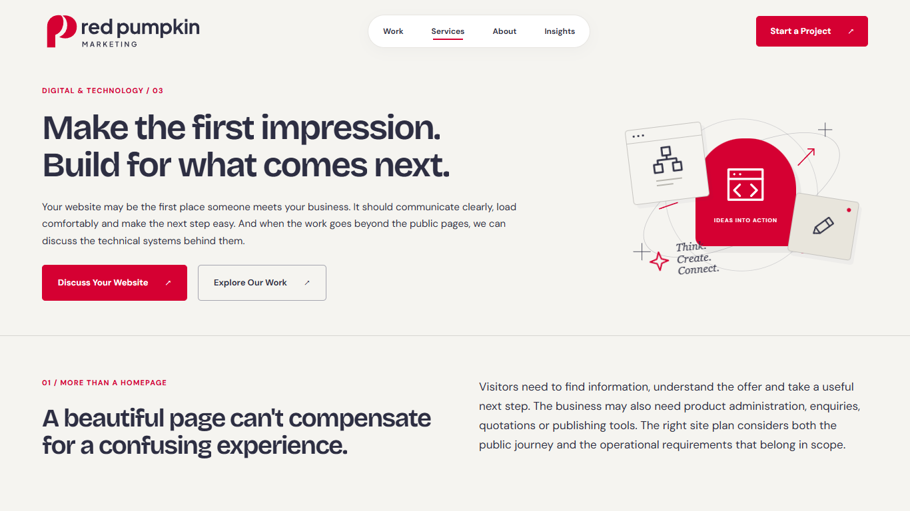
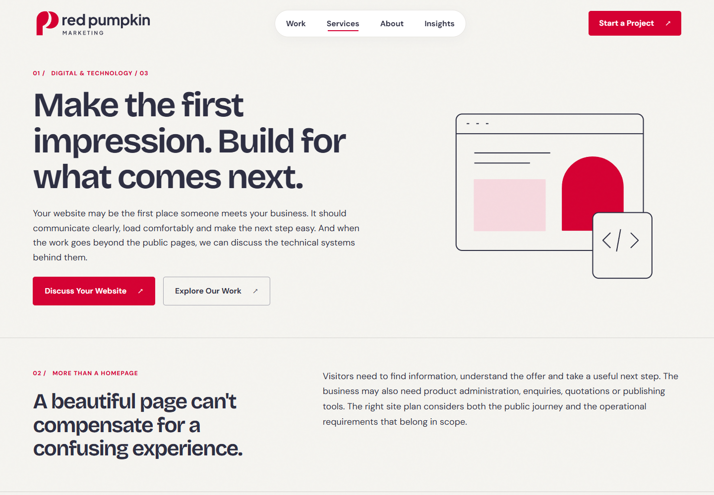

# Red Pumpkin Marketing — final quality review

20 October 2026. Local preview only; nothing published or deployed.

## What was fixed

- Removed internal editorial instructions from visitor-facing case studies and service copy. Approved source documents remain unchanged.
- Fixed the service/footer text strips so they wrap cleanly when reduced motion is enabled.
- Restored an approved footer sentence caught by the copy-regression test.
- Updated older tests to check the current headline animation and full-screen mobile menu.

## Verification

- Build and source checks: passed, with zero errors or warnings. All 20 static pages built successfully.
- All 13 browser regression suites passed; additional accessibility checks passed for the 404, article template and design-reference pages.
- All rendered internal links and section anchors resolve. No missing images, duplicate IDs, page overflow, detected text overlap or browser exceptions in the final 100-capture review.
- Visitor-facing copy is free of the checked internal directives, including “CTA:”, “Signature:”, “we do not claim” and unverified-outcome instructions. Intentional asset placeholders remain.
- Mobile Lighthouse: **95–99 performance and 100 accessibility across all 17 main pages**. Homepage: **98 performance / 100 accessibility**. Both requested targets were met. [Detailed score table](lighthouse-scores.md).

The screenshot review covers all 20 built pages at **390, 768, 1280, 1440 and 1920 pixels**: 100 full-page screenshots plus 100 viewport captures. It includes the article template, design foundation and 404 page. The full screenshot gallery is retained in the local workspace; selected before/after screenshots are included below.

Screenshots use reduced motion for stable inspection. Separate motion tests exercise animations, page transitions, reduced-motion switching and layout stability. The hero is also checked at 1280×600, 1366×768, 1920×1080 and 390×844.

Evidence: [test suites](test-suite-report.json), [layout/link review](final-review.json), [accessibility results](accessibility-report.json), [form checks](conversion-report.json), [hero fit](hero-report.json), [animation stability](motion-routes.json).

## Before / after

“Before” means the earlier local design captured before the staged redesign, not a live-site screenshot. “After” is the final local build. Viewport widths differ slightly (earlier 1366px, final 1440px).

| Page | Earlier design | Final design |
| --- | --- | --- |
| Homepage |  |  |
| Contact |  |  |
| Website service |  |  |

## What RPM still needs to provide

- Approved screenshots for ETPRA Group, Hill's Polymers, India Career Counseling and Loka Samabaya Pratisthan; permission to display any internal systems.
- Approved client logos and permission to use them. RPM's own logo and favicon are already installed.
- Founder/team photos, names and roles approved for publication.
- Genuine testimonials with client approval, name and role, if testimonials are wanted. None have been invented.
- WhatsApp number with country code, contact email and city.
- Formspree form endpoint, or Web3Forms endpoint plus its public access key. Sending stays disabled until configured.
- Instagram, LinkedIn and Facebook profile links.
- Approved article copy, author information and imagery before publishing Insights articles.

Missing media remains clearly marked. WhatsApp/email placeholders lead to the Contact page instead of invented destinations. Social placeholders are not live links. Form success/error handling is tested with intercepted test responses; no real enquiries are sent. Live email delivery cannot be verified until the real form service is configured.

Lighthouse scores are local laboratory measurements, not a guarantee of hosted performance. Automated accessibility checks do not replace a full assistive-technology audit. Hosting and real content should receive a final check before any separately approved launch.
